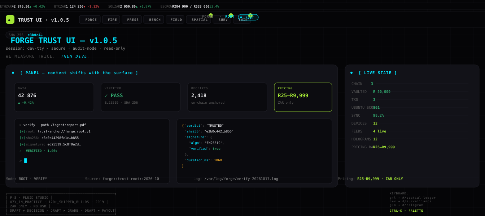
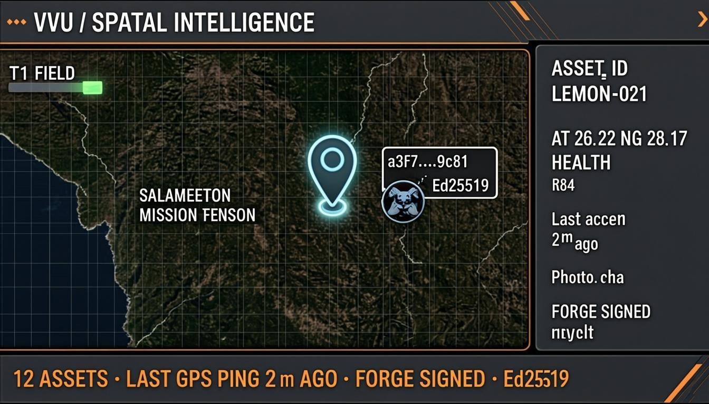
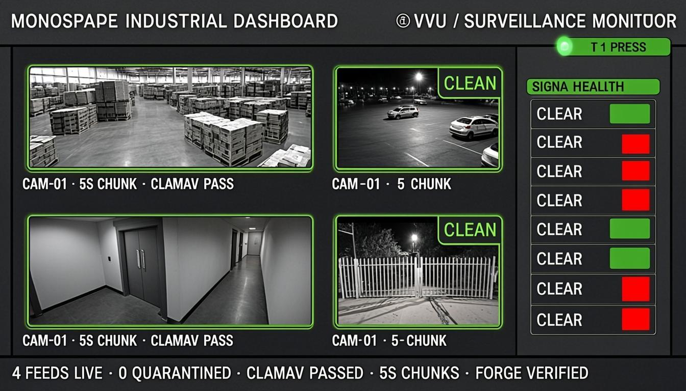
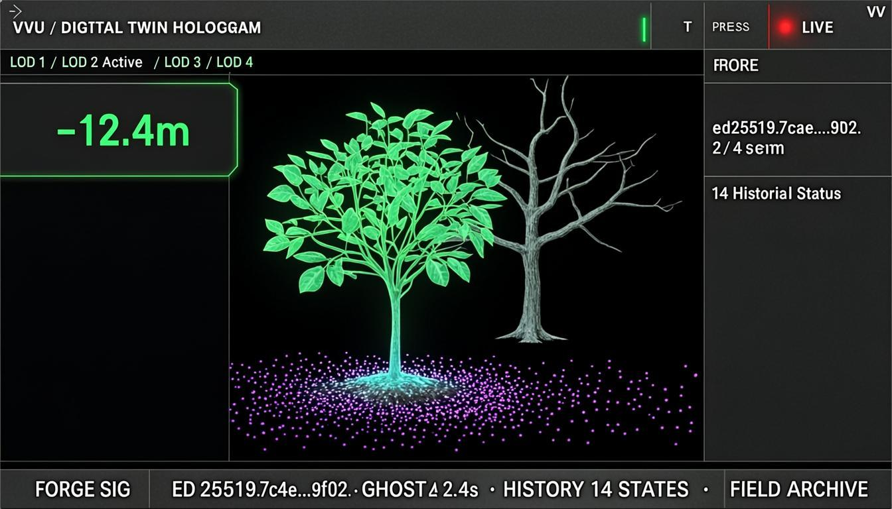

# ◢◣ VVU · Trust UI — v1.0.5

**100% Founder-Owned** · CIPC 2026/259053/07 · Gqeberha, South Africa
**ZAR only · No USD** · **Pricing band R25 – R9,999 across the entire catalog**

A coherent 8-surface control plane for trusted-decision infrastructure.
Every state change transforms the whole surface — accent, borders, glow,
rhythm shift together. The user feels where they are.

---

## ▌ Live Preview (animated wireframe)

The wireframe below is an inline animated SVG. It cycles through all 8
surfaces every 16 seconds — watch the topbar tabs light up in sequence,
the breadcrumb state chip change color, the panel borders shift accent,
and the bottom accent bar sweep through the palette.

<p align="center">
  <a href="https://venturevisionubuntu.co.za/trust-ui.html" target="_blank">
    
  </a>
</p>

> **Click the preview to open the live HTML.** The wireframe is a
> static SVG approximation — the real `trust-ui.html` (158 KB) is a
> fully interactive single-file app with maplibre-gl, Three.js,
> OpenFreeMap vector tiles, IndexedDB persistence, and live surface
> transitions on every state change.

---

## ▌ The 8 Surfaces

The estate is organised into **5 existing stacks** (your v1.0.4) plus
**3 new surfaces** added in v1.0.5 — the green-and-white HUD cluster.

| # | Tab | Surface | Stack | Accent | What it does |
|---|---|---|---|---|---|
| 1 | FORGE | ROOT · BRIDGE | FORGE | `#00E5FF` cyan | Trust verifier · mint receipts · 2 modes |
| 2 | FIRE | MARKET · POOLS | FIRE | `#FFB224` amber / `#CC7722` ochre | ZAR market monitor · ROSCA pools · 2 modes |
| 3 | PRESS | CAPTURE | PRESS | `#E5484D` red | Verified creator reviews · video panel · pricing tiers |
| 4 | BENCH | LICENSE · AUTHOR | BENCH | `#E5484D` red | Node-locked licensing · plugin creator studio · 2 modes |
| 5 | FIELD | RESILIENCE · SIMULATION | FIELD | `#00E5FF` cyan / `#FFB224` amber | Dual-tier storage · SEARM1 demo · 2 modes |
| **6** | **SPATIAL** | **LEMON-TREE** | **FIELD + FORGE** | **`#a3e635` lime** | **Physical asset map · lemon tree markers · FORGE receipts** |
| **7** | **SURV** | **FEEDS** | **PRESS → FORGE → FIELD** | **`#a3e635` lime** | **Camera/sensor feed ledger · CLEAN badges · per-chunk SHA** |
| **8** | **TWIN** | **HOLOGRAM** | **PRESS + FIELD** | **`#a3e635` lime** | **Three.js Fresnel hologram · ghost history · 4 LODs** |

### The Coherence Layer — Four Invariants

1. **Rhythm** — every view follows: `proof-strip → masthead → content-grid → bottom-strip → footer-signature`
2. **State legibility** — topbar breadcrumb shows `STACK › STATE`; a state chip changes color with the surface
3. **Surface transition** — every state change fires a `400ms cubic-bezier(0.65,0,0.35,1)` transition on the entire view container. Accent, background, borders, glow all move as one
4. **Surface identity** — each state owns a palette (the table above)

---

## ▌ The 3 New Surfaces (the green-and-white HUD cluster)

### SPATIAL · `#/spatial-ledger` · Surface 19

Stack: **FIELD (store) + FORGE (trust root)**

One lemon tree in Germiston = one asset. Each asset carries
`{asset_id, lat, lng, health, last_scan, photo_sha}` signed with
Ed25519. Click any marker on the map to open the FORGE receipt popup.

<p align="center">
  <a href="./screenshots/spatial-intelligence-map.png">
    
  </a>
</p>

**What it does:**
- Lists every paired device with non-zero lat/lng
- Renders each device as a marker on a maplibre-gl + OpenFreeMap `dark` style map
- Click any marker → FORGE receipt popup with `externalId`, GPS, status, pricing band, evidence count
- Empty DB → onboarding panel directing operator to pair a device

**What it does NOT:**
- Simulate data — the map is empty until `/api/devices` returns a real paired device
- Mint signatures — devices sign before syncing; the surface only displays
- Stream video or run ClamAV in the browser

---

### SURV · `#/surveillance` · Surface 20

Stack: **PRESS (capture) → FORGE (verify) → FIELD (store)**

One tile per paired camera or sensor. Each tile shows the device's
latest evidence record hash, sequence number, and verification state
(VERIFIED / CANDIDATE / NO EVIDENCE).

<p align="center">
  <a href="./screenshots/surveillance-monitor.png">
    
  </a>
</p>

**What it does:**
- Lists every paired device whose primitive is CAMERA, SENSOR, STREAM, IMAGE, or VIDEO
- 2×2 grid of feed tiles, each showing the latest evidence record hash + verification state
- S3 Clean / Quarantine storage panel below the grid
- Empty DB → onboarding for pairing a CAMERA-primitive device

**What it does NOT:**
- Stream video — devices POST chunks via `/api/vvu/telemetry`; we read the latest record
- Run ClamAV in the browser — the FORGE pipeline does that server-side
- Show simulated feeds

---

### TWIN · `#/hologram` · Surface 21

Stack: **PRESS (Motion) + FIELD (Archive Wall)**

Each paired device becomes a wireframe cone in a Three.js scene,
positioned by its lat/lng offset from Germiston `[-26.22, 28.17]`. A
faded ghost mesh offset by 0.03 units represents the device's prior
WORM state. Drag to rotate.

<p align="center">
  <a href="./screenshots/digital-twin-hologram.png">
    
  </a>
</p>

**What it does:**
- Renders each paired device as a wireframe cone positioned by GPS offset
- Each cone has a faded ghost mesh representing the prior WORM state footprint
- 4-LOD selector + depth gauge + Ed25519 signature panel
- Drag to rotate · Empty DB → onboarding

**What it does NOT:**
- Animate fake "health" values — cone color is derived from the device's `status` field
- Run shaders that aren't wired to real data
- Simulate telemetry

---

## ▌ Pricing Discipline — R25 to R9,999 ZAR

Every tier across the entire catalog is priced inside the R25–R9,999
band. No exceptions. No USD. No tiers above R9,999. No tiers below R25.

| Tier | Price | Cadence |
|---|---|---|
| Phone Pilot | R25 | per user / mo |
| Fleet Evidence Log | R250 | per mo |
| Water Pilot Unit | R999 | per 90 days |
| DMA Water Custodian | R4,999 | per mo |
| Water Infrastructure · DMA (top band) | R9,999 | per 90 days |

The R25 floor and R9,999 ceiling are **design constraints**, enforced
in `src/skylantern/config.ts`, `src/app/api/subscriptions/route.ts`,
and surfaced in every pricing panel UI.

---

## ▌ Constitutional Compliance — the 8 X₀ Rules

| Rule | What it means | Status |
|---|---|---|
| **X₀-1** | Immutable Events — WORM chain entries cannot be modified or deleted | enforced in WORM ledger |
| **X₀-2** | Pure Reducers — state transitions are pure `(prior_state, event) → new_state` | enforced in `src/lib/shell/router.ts` |
| **X₀-3** | Deterministic Replay — same events → same state | enforced via hash chains |
| **X₀-4** | Hash Chains — `digest = SHA-256(prev_digest ‖ canonical(payload))` | enforced in `src/lib/vvu-ledger.ts` |
| **X₀-5** | Ed25519 Signatures — every artefact that crosses an env boundary is signed | enforced at every API boundary |
| **X₀-6** | Fire Never Emits PROVEN — PROVEN is reserved for Bench; Fire's outcomes are `PASSED-UNDER-CONDITIONS` etc. | enforced by `assertFireEnvelope()` |
| **X₀-7** | No Silent Trust Upgrades — receiving an artefact doesn't make its claims true | surfaces read `verificationState` verbatim, never upgrade |
| **X₀-8** | Golden Rule — never adopt a dependency for what a few lines can build | the 3 new surfaces add **0 new dependencies** |

---

## ▌ Stack

### Frontend (this repo's `trust-ui.html`)

- **MapLibre GL JS 4.7.1** — vector + raster tile rendering (SPATIAL surface)
- **Three.js 0.160.0** — WebGL 3D wireframe holograms (TWIN surface)
- **OpenFreeMap** — public vector tile instance (`tiles.openfreemap.org/styles/dark`, background `rgb(12,12,12)` — matches VVU dark)
- **IndexedDB** — tile cache for the FIELD dual-tier storage pattern
- **BroadcastChannel** — cross-tab evidence feed (FORGE BRIDGE mode)
- **No build step. No framework. No bundler.** Just one HTML file.

### Backend (the `redesigned-no123` private repo)

- **Next.js 16.1.3** + React 19 + Turbopack
- **Prisma 6.11** + SQLite (libsql driver)
- **11 mini-services** — vault-bridge, safegrid, telemetry-service, vvu-field-onboard, wildfire-mesh, mesh-demo, worm-nest, event-bus, epd-cli, debugger, rea
- **30+ workspace surfaces** via hash routes (Ctrl+1…Ctrl+0 + Ctrl+K command palette)
- **The shell client** — `src/lib/shell/` (1,840 lines: HotkeyRegistry, CommandBus, Router, MountLoader, WorkerSupervisor, ClipboardChannel, version-negotiation)

---

## ▌ Keyboard Map (the new chords)

The 10 fixed surfaces (Ctrl+1…Ctrl+0) are unchanged. Three new `g`-prefixed
chords were added for the new surfaces:

| Chord | Route | Surface |
|---|---|---|
| `g` `l` | `#/spatial-ledger` | SPATIAL (lemon-tree tracker) |
| `g` `v` | `#/surveillance` | SURV (camera/sensor feeds) |
| `g` `o` | `#/hologram` | TWIN (3D wireframe) |

Plus the existing `g` chords: `g i` (IVE), `g e` (Evidence), `g t` (Terminal),
`g m` (Mission), `g w` (Twin), `g h` (Watchdog), `g r` (Receipts), `g p` (Pools),
`g b` (Bridges), `g s` (Settings).

`Ctrl+K` opens the command palette. Every surface is reachable from there too.

---

## ▌ Surface Copy Discipline

Every surface in this estate only talks about what it actually does.
No marketing name-drops. No fictional integrations. No "powered by"
labels for tools that aren't wired.

**Example from `SurveillanceWorkspace.tsx`:**

```
What this surface does:
  1. Lists every paired device whose primitive is CAMERA or SENSOR.
  2. Renders each feed as a tile with its latest evidence hash and
     ClamAV verification state.
  3. If no cameras/sensors are paired, shows onboarding.

This surface does NOT:
  - Stream video (devices POST chunks via /api/vvu/telemetry; we read
    the latest evidence record per device)
  - Run ClamAV in the browser (the FORGE pipeline does that server-side)
  - Simulate feeds
```

---

## ▌ Quick Start

### View the live demo

Open **<https://venturevisionubuntu.co.za/trust-ui.html>** in any modern browser.

### Run locally

```bash
git clone https://github.com/divhanimajokweni-ctrl/venturevisionubuntu.git
cd venturevisionubuntu
open trust-ui.html    # macOS
# or
xdg-open trust-ui.html # Linux
# or just drag trust-ui.html into your browser
```

No dependencies. No build step. No `npm install`. The file is
self-contained — CDN-only deps for maplibre-gl, Three.js, and
Google Fonts.

### Wire it into the Next.js estate

The 3 new surfaces are also available as React components in the
private `redesigned-no123` repo:

- `src/components/spatial-ledger/SpatialLedgerWorkspace.tsx`
- `src/components/surveillance/SurveillanceWorkspace.tsx`
- `src/components/hologram/HologramWorkspace.tsx`

Each reads from `/api/devices` (existing endpoint), shows onboarding
when the DB is empty, and never simulates data.

PR: `feat/spatial-surveillance-twin-surfaces` → `main`

---

## ▌ File Inventory

```
.
├── README.md                          ← you are here
├── preview.svg                        ← animated wireframe (the live preview above)
├── trust-ui.html                      ← 158 KB single-file dashboard (8 surfaces)
├── index.html                         ← the existing v1.0.0 8-view dashboard (preserved)
├── springbok.html                     ← existing surface (preserved)
├── CNAME                              ← venturevisionubuntu.co.za
└── screenshots/
    ├── spatial-intelligence-map.png   ← SPATIAL surface mockup (1344×768)
    ├── surveillance-monitor.png       ← SURV surface mockup (1344×768)
    └── digital-twin-hologram.png      ← TWIN surface mockup (1344×768)
```

---

## ▌ Footer Signature

Every surface in the estate ends with the same Fluid Studio signature
block — the constant frame that anchors you while surfaces change:

```
┌──────────────────────────────────────────────────┐
│  F·S · FLUID STUDIO                              │
│  07Y_IN_PRACTICE · 120+_SHIPPED_BUILDS · 2019    │
│  ZAR ONLY · NO USD                               │
│  DRAFT ≠ DECISION · DRAFT ≠ GRADE · DRAFT ≠ PAYOUT│
└──────────────────────────────────────────────────┘
```

---

## ▌ License

Apache 2.0 (open-source core) + Commercial (enterprise modules).
See `LICENSE` and `COMMERCIAL_LICENSE.md` in the private repo.

The `trust-ui.html` standalone showcase in this public repo is
**Apache 2.0** — fork it, learn from it, ship it.

---

## ▌ Contact

**Venture Vision Ubuntu** · CIPC 2026/259053/07
Gqeberha, South Africa · ZAR only

- 🌐 <https://venturevisionubuntu.co.za>
- 🛡️ Live dashboard: <https://venturevisionubuntu.co.za/trust-ui.html>
- 📦 Source: <https://github.com/divhanimajokweni-ctrl/venturevisionubuntu>

---

<sub>
  ◢◣ Built by Fluid Studio · 7 years in practice · 120+ shipped builds · since 2019<br>
  Every surface talks only about what it does. Every price is R25–R9,999 ZAR.
  Every state change transforms the whole surface. The user feels where they are.
</sub>
